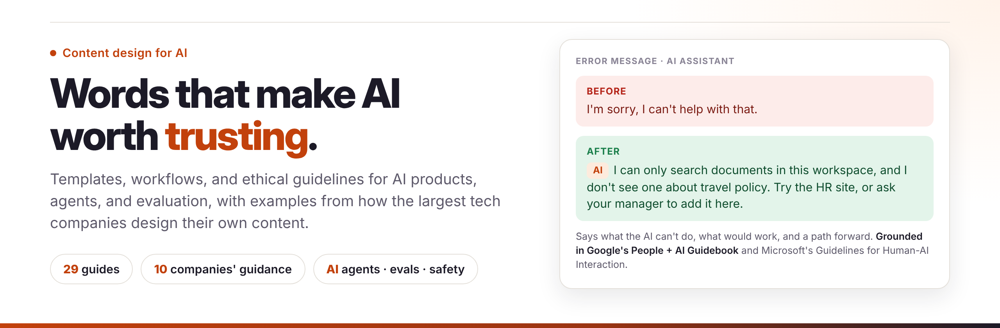

<p align="center"></p>

# AI Content Design Handbook

<p>
  <a href="https://jkelleman.github.io/ai-content-design-handbook/"></a>
  
  <a href="resources/industry-examples.md"></a>
  <a href="LICENSE"></a>
  <a href="CONTRIBUTING.md"></a>
  <br>
  
  
  
  
  
</p>

**Templates, workflows, and ethical guidelines for designing the words in AI products: assistants, agents, and everything around them.** Every guide includes examples from how Google, Microsoft, Apple, Amazon, Meta, IBM, Salesforce, Adobe, Atlassian, and Shopify design their own content, linked to the public source so you can check it.

## What's new

- **[How Leading Companies Design Content for AI](resources/industry-examples.md):** what 10 companies' public guidance teaches, side by side, including where they disagree
- **[Agentic AI Experiences](templates/ai-content/agentic-experiences.md):** content for AI that acts: plans, approvals, progress, receipts, and recovery
- **[LLM-as-a-Judge](workflows/testing/llm-as-a-judge.md):** turn content principles into rubrics and calibrate automated judges against people
- **EU AI Act Article 50**, in force since August 2, 2026: what it requires of AI disclosures, in the [Transparency Guidelines](resources/ethical-ai/transparency-guidelines.md)
- **Rewritten message templates:** [error messages](templates/messages/error-messages.md), [success messages](templates/messages/success-messages.md), and [empty states](templates/messages/empty-states.md), each with AI-specific patterns
- **A "How leading companies do it" section on every page,** with sources

## Start here

| If you're… | Read |
|---|---|
| New to AI content design | [AI Content Strategy](templates/ai-content/ai-content-strategy.md) → [Industry examples](resources/industry-examples.md) → [Transparency](resources/ethical-ai/transparency-guidelines.md) |
| Designing an assistant or chatbot | [Conversation Flows](templates/conversational/conversation-flows.md) → [Prompt Design](templates/ai-content/prompt-design.md) → [Content Safety](resources/ethical-ai/content-safety.md) |
| Designing an AI agent | [Agentic AI Experiences](templates/ai-content/agentic-experiences.md) → [Confirmation Dialogs](templates/flows/confirmation-dialogs.md) → [Error Messages](templates/messages/error-messages.md) |
| Evaluating AI output | [AI Content Evaluation](workflows/testing/ai-content-evaluation.md) → [LLM-as-a-Judge](workflows/testing/llm-as-a-judge.md) → [Content Metrics](workflows/testing/content-metrics.md) |
| Writing UI copy | [Error Messages](templates/messages/error-messages.md) → [Microcopy](templates/messages/microcopy.md) → [Voice and Tone](style-guides/voice-and-tone-framework.md) |
| Starting a project | [Content Design Starter](content_design_starter.md) |

## What's inside

### Templates

| Guide | What it covers |
|---|---|
| [Error Messages](templates/messages/error-messages.md) | Error anatomy, components by severity, AI error types, tone scale |
| [Success Messages](templates/messages/success-messages.md) | When to confirm, receipts for AI and agent actions |
| [Empty States](templates/messages/empty-states.md) | First use, no results, waiting, and AI with nothing to suggest |
| [Microcopy](templates/messages/microcopy.md) | Buttons, links, fields, settings, and AI labels and prompts |
| [Onboarding](templates/flows/onboarding.md) | First success, returning users, onboarding to AI features |
| [Confirmation Dialogs](templates/flows/confirmation-dialogs.md) | Confirmations that work, and approvals for AI agent actions |
| [Release Notes](templates/documentation/release-notes.md) | User-focused release notes, including AI behavior changes |
| [Prompt Design](templates/ai-content/prompt-design.md) | System prompts as product content, grounding, guardrail layers |
| [Content as Data](templates/ai-content/content-as-data.md) | Structuring content for retrieval and AI explanations |
| [AI Content Strategy](templates/ai-content/ai-content-strategy.md) | Planning AI content, with how 6 companies approach it |
| [Agentic AI Experiences](templates/ai-content/agentic-experiences.md) | Plan, approve, progress, and receipt content for agents |
| [Conversation Flows](templates/conversational/conversation-flows.md) | Chatbot and voice patterns, clarifying instead of guessing |

### Workflows

| Guide | What it covers |
|---|---|
| [Git Workflow](workflows/git-workflow.md) | Version control for content designers; docs-as-code |
| [Content Review Process](workflows/content-review-process.md) | Review stages, including prompts and AI output |
| [Content Testing](workflows/testing/content-testing.md) | Five testing methods, plus testing AI-generated content |
| [Content Metrics](workflows/testing/content-metrics.md) | Measuring content, including AI-specific metrics |
| [A/B Testing](workflows/testing/ab-testing-content.md) | Rigorous experiments, including AI variants |
| [AI Content Evaluation](workflows/testing/ai-content-evaluation.md) | Assessing AI output quality |
| [LLM-as-a-Judge](workflows/testing/llm-as-a-judge.md) | Rubrics, golden sets, calibration, and planted-defect tests |

### Resources and style guides

| Guide | What it covers |
|---|---|
| [How Leading Companies Design Content for AI](resources/industry-examples.md) | 10 companies' guidance, with sources and patterns across them |
| [Accessibility Guidelines](resources/accessibility-guidelines.md) | WCAG for content, plus AI and accessibility |
| [Ethical AI Guidelines](resources/ethical-ai/ethical-ai-guidelines.md) | Six principles, and how companies make principles concrete |
| [Bias Detection](resources/ethical-ai/bias-detection.md) | Seven types of bias and how to find them |
| [Content Safety](resources/ethical-ai/content-safety.md) | Preventing harm and handling crises |
| [Transparency Guidelines](resources/ethical-ai/transparency-guidelines.md) | AI disclosure, labels, provenance, and EU AI Act Article 50 |
| [Voice and Tone Framework](style-guides/voice-and-tone-framework.md) | Defining voice, flexing tone, AI voice |
| [Terminology Guidelines](style-guides/terminology-guidelines.md) | Consistent, inclusive terms, including terms for AI |
| [Before and After Examples](examples/before-after-examples.md) | 27 rewrites, including 9 drawn from company guidance |

## How to use it

1. **Read online** at [jkelleman.github.io/ai-content-design-handbook](https://jkelleman.github.io/ai-content-design-handbook/), or clone the repo:
   ```bash
   git clone https://github.com/jkelleman/ai-content-design-handbook.git
   ```
2. **Copy a template** into your project and replace the examples with your own.
3. **Adapt the rules to your style guide.** Where companies disagree (for example, whether to say "we" in error messages), the guides say so. Pick one approach and use it consistently.
4. **Check the sources.** Company examples are paraphrased from public guidance and linked. Guidance changes, so the source wins.

## About the company examples

Examples are drawn only from guidance each company publishes: design systems, style guides, research papers, and transparency documentation. They're paraphrased, attributed, and linked. This handbook isn't affiliated with or endorsed by any of these companies.

## Contributing

Contributions are welcome: new templates, better examples, corrections when a company updates its guidance, and real-world case studies. See [CONTRIBUTING.md](CONTRIBUTING.md).

## About

Created by **[Jen Kelleman](https://github.com/jkelleman)**, a content designer for AI and data experiences, based on years of designing content for enterprise data and AI platforms, conversational interfaces, and responsible AI practices.

[LinkedIn](https://www.linkedin.com/in/jenniferkelleman) · [Medium](https://jenkelleman.medium.com) · [Portfolio](https://aiwithjen.com) · [GitHub](https://github.com/jkelleman)

**Related projects:** [Airbnb LLM-as-a-Judge Listing Evals](https://github.com/jkelleman/airbnb-llm-as-a-judge-listing-evals) applies this handbook's evaluation guidance end to end, and [AI-Assisted Insights Agent](https://github.com/jkelleman/ai-assisted-insights-agent) applies its explainability patterns.

## License

[MIT](LICENSE). Use and adapt freely.
