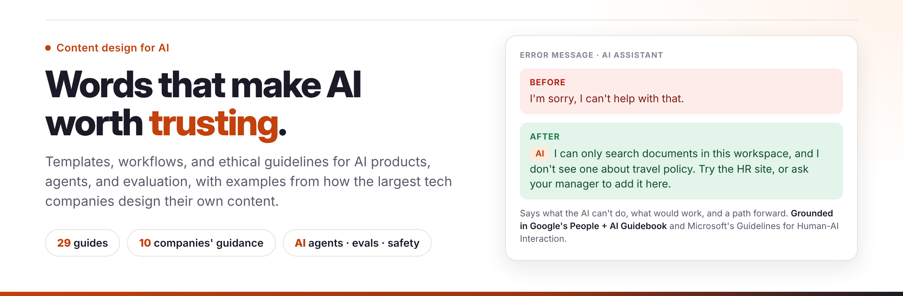

# AI Content Design Handbook

A working handbook for designing the words in AI products: what an assistant or agent says, the guidelines and prompts that teach it to say it, and the rubrics that check what it wrote.

By **Jen Kelleman**, principal content designer at Microsoft. Portfolio and case studies at [aiwithjen.com](https://aiwithjen.com).

## Start here

If you read three pages, read these. Together they cover what changes when AI acts on its own, how to grade what it writes, and the pattern every message needs.

  <a href="templates/ai-content/agentic-experiences.html"><strong>Agentic AI experiences</strong>Plans, approvals, progress and receipts for AI that takes actions on someone's behalf.</a>
  <a href="workflows/testing/llm-as-a-judge.html"><strong>LLM-as-a-judge</strong>Turn content principles into rules a model can grade against, and prove the grades can be trusted.</a>
  <a href="templates/messages/error-messages.html"><strong>Error messages</strong>What happened, why it matters and what to do next, including errors only AI features make.</a>

## How the handbook is organized

- **Templates and frameworks** are written to be used as-is: copy a template, follow the steps, check against the list at the end.
- **Industry reference** is compiled from public sources. [How 11 leading companies design content for AI](resources/industry-examples.md) paraphrases each company's published guidance and links to it. Every other page draws on it where a company's example helps.
- **Examples** use a fictional product, DataFlow. Numbers in sample dashboards and test results are illustrative.

Each guide opens with an **In brief** summary, so you can skim the whole handbook in a few minutes.

## Find what you need

**Designing for AI assistants and agents**
1. [AI Content Strategy](templates/ai-content/ai-content-strategy.md) and [How Leading Companies Design Content for AI](resources/industry-examples.md)
2. [Agentic AI Experiences](templates/ai-content/agentic-experiences.md)
3. [Prompt Design](templates/ai-content/prompt-design.md)
4. [Transparency Guidelines](resources/ethical-ai/transparency-guidelines.md)

**Building a chatbot or conversational interface**
1. [Conversation Flows](templates/conversational/conversation-flows.md)
2. [Prompt Design](templates/ai-content/prompt-design.md)
3. [Content Safety](resources/ethical-ai/content-safety.md)
4. [Bias Detection](resources/ethical-ai/bias-detection.md)

**Checking quality and measuring results**
1. [Evaluating AI-Generated Content](workflows/testing/ai-content-evaluation.md)
2. [LLM-as-a-Judge](workflows/testing/llm-as-a-judge.md)
3. [Content Testing](workflows/testing/content-testing.md) and [Content Metrics](workflows/testing/content-metrics.md)
4. [A/B Testing for Content](workflows/testing/ab-testing-content.md)

**Writing product messages**
1. [Error Messages](templates/messages/error-messages.md), [Success Messages](templates/messages/success-messages.md) and [Empty States](templates/messages/empty-states.md)
2. [Microcopy](templates/messages/microcopy.md)
3. [Accessibility Guidelines](resources/accessibility-guidelines.md)
4. [Content Review Process](workflows/content-review-process.md)

## All guides

### AI and conversational content
- [Agentic AI Experiences](templates/ai-content/agentic-experiences.md): plans, approvals, progress and receipts for AI agents
- [AI Content Strategy](templates/ai-content/ai-content-strategy.md): plan content for products where language is generated
- [Prompt Design](templates/ai-content/prompt-design.md): write the instructions that govern how AI writes
- [Content as Data](templates/ai-content/content-as-data.md): structure content so AI can retrieve and reuse it
- [Conversation Flows](templates/conversational/conversation-flows.md): map how a chatbot guides people through a task

### Product messages and flows
- [Error Messages](templates/messages/error-messages.md): clear, actionable errors
- [Success Messages](templates/messages/success-messages.md): specific confirmations
- [Empty States](templates/messages/empty-states.md): what belongs here and how to start
- [Microcopy](templates/messages/microcopy.md): buttons, links and UI text
- [Onboarding Flows](templates/flows/onboarding.md): first success, fast
- [Confirmation Dialogs](templates/flows/confirmation-dialogs.md): stop the mistakes that matter, and only those
- [Release Notes](templates/documentation/release-notes.md): changes written for the people affected
- [Before and After Examples](examples/before-after-examples.md): rewrites across message types

### Voice and terminology
- [Voice and Tone Framework](style-guides/voice-and-tone-framework.md): define a voice and how it adapts
- [Terminology Guidelines](style-guides/terminology-guidelines.md): one word for one thing
- [Content Design Starter Template](content_design_starter.md): plan content for a new feature

### Quality, testing and measurement
- [Evaluating AI-Generated Content](workflows/testing/ai-content-evaluation.md): a rubric for accuracy, helpfulness, tone and safety
- [LLM-as-a-Judge](workflows/testing/llm-as-a-judge.md): calibrate automated judges against people
- [Content Testing](workflows/testing/content-testing.md): five ways to test content
- [Content Metrics](workflows/testing/content-metrics.md): measure whether content works
- [A/B Testing for Content](workflows/testing/ab-testing-content.md): run experiments you can trust
- [Content Review Process](workflows/content-review-process.md): structured review and approval

### Responsible AI
- [Ethical AI Guidelines](resources/ethical-ai/ethical-ai-guidelines.md): six principles for responsible AI content
- [Bias Detection](resources/ethical-ai/bias-detection.md): find and fix seven types of bias
- [Content Safety](resources/ethical-ai/content-safety.md): prevent harm and protect people
- [Transparency Guidelines](resources/ethical-ai/transparency-guidelines.md): disclose AI use clearly
- [Accessibility Guidelines](resources/accessibility-guidelines.md): content everyone can use

### Industry reference (compiled from public sources)
- [How Leading Companies Design Content for AI](resources/industry-examples.md): what 11 companies' public guidance teaches, side by side

## About

Written by Jen Kelleman, a content designer for AI and data products. Read her case studies at [aiwithjen.com](https://aiwithjen.com), or find her on [LinkedIn](https://www.linkedin.com/in/jenniferkelleman), [Medium](https://jenkelleman.medium.com) and [GitHub](https://github.com/jkelleman).

Company examples are paraphrased from public guidance and linked. This handbook isn't affiliated with or endorsed by any of the companies it cites. Suggestions are welcome as [issues on GitHub](https://github.com/jkelleman/ai-content-design-handbook/issues).
