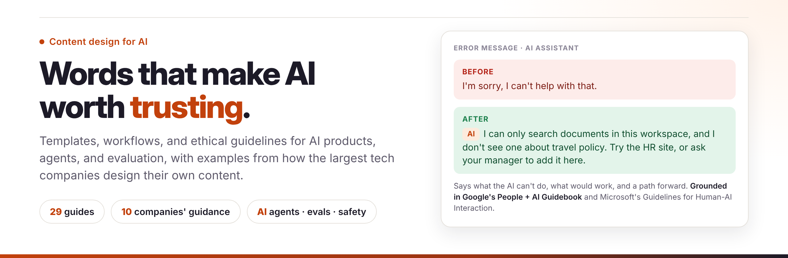

# AI Content Design Handbook

Templates, workflows, and ethical guidelines for designing the words in AI products: assistants, agents, and everything around them. Every guide includes examples from how Google, Microsoft, Apple, Amazon, Meta, IBM, Salesforce, Adobe, Atlassian, and Shopify design their own content, with links to the public sources.

## What Makes This Different

🤖 **AI-First Approach** - Extensive resources for prompt engineering, AI content strategy, and conversational design

⚖️ **Ethics Built-In** - Comprehensive guidelines for bias detection, content safety, and transparency

📊 **Measurement-Focused** - Real frameworks for testing, metrics, and A/B testing content

🏢 **Grounded in Industry Practice** - [How 10 leading companies design content for AI](resources/industry-examples.md), with sources

🤝 **Ready for Agents** - [Content patterns for AI that takes actions](templates/ai-content/agentic-experiences.md)

## Get Started

**New to AI content design?**
1. Start with [AI Content Strategy](templates/ai-content/ai-content-strategy.md) and [How Leading Companies Design Content for AI](resources/industry-examples.md)
2. Review [Ethical AI Guidelines](resources/ethical-ai/ethical-ai-guidelines.md)
3. Learn [Prompt Design](templates/ai-content/prompt-design.md)
4. Understand [Transparency Guidelines](resources/ethical-ai/transparency-guidelines.md)

**Building a chatbot or conversational interface?**
1. Explore [Conversation Flows](templates/conversational/conversation-flows.md)
2. Apply [Prompt Design](templates/ai-content/prompt-design.md) principles
3. Check [Content Safety](resources/ethical-ai/content-safety.md) guidelines
4. Review [Bias Detection](resources/ethical-ai/bias-detection.md) framework

**Need to measure content effectiveness?**
1. Start with [Content Testing](workflows/testing/content-testing.md) methods
2. Track [Content Metrics](workflows/testing/content-metrics.md)
3. Run [A/B Tests](workflows/testing/ab-testing-content.md)
4. Evaluate [AI Content Quality](workflows/testing/ai-content-evaluation.md)

**Working on traditional content?**
1. Browse [message templates](templates/messages/)
2. Review [accessibility guidelines](resources/accessibility-guidelines.md)
3. Follow [Git workflow](workflows/git-workflow.md)
4. Implement [content review process](workflows/content-review-process.md)

## Templates

### AI & Conversational Content
- [Prompt Design](templates/ai-content/prompt-design.md) - Engineer effective prompts for AI systems
- [Content as Data](templates/ai-content/content-as-data.md) - Structure content for AI consumption
- [AI Content Strategy](templates/ai-content/ai-content-strategy.md) - Plan AI-powered content experiences
- [Conversation Flows](templates/conversational/conversation-flows.md) - Design chatbot and conversational UI
- [Agentic AI Experiences](templates/ai-content/agentic-experiences.md) - Plans, approvals, progress, and receipts for AI agents

### Core Content Patterns
- [Error Messages](templates/messages/error-messages.md) - Clear, actionable error content
- [Success Messages](templates/messages/success-messages.md) - Effective confirmations
- [Empty States](templates/messages/empty-states.md) - Guide users when content is missing
- [Microcopy](templates/messages/microcopy.md) - Buttons, links, and UI text
- [Onboarding Flows](templates/flows/onboarding.md) - First-time user experiences
- [Confirmation Dialogs](templates/flows/confirmation-dialogs.md) - Prevent errors with clear confirmations
- [Release Notes](templates/documentation/release-notes.md) - User-focused release communication

## Workflows

### Testing & Measurement
- [Content Testing](workflows/testing/content-testing.md) - 5 testing methods with frameworks
- [Content Metrics](workflows/testing/content-metrics.md) - Measure effectiveness and ROI
- [A/B Testing for Content](workflows/testing/ab-testing-content.md) - Run rigorous experiments
- [AI Content Evaluation](workflows/testing/ai-content-evaluation.md) - Assess AI-generated content quality
- [LLM-as-a-Judge](workflows/testing/llm-as-a-judge.md) - Calibrate automated judges against people

### Version Control & Review
- [Git Workflow for Content Designers](workflows/git-workflow.md) - Version control basics
- [Content Review Process](workflows/content-review-process.md) - Structured review and approval

## Ethical AI Resources

### Core Principles
- [Ethical AI Guidelines](resources/ethical-ai/ethical-ai-guidelines.md) - 6 principles for responsible AI content
- [Bias Detection](resources/ethical-ai/bias-detection.md) - Identify and mitigate 7 types of bias
- [Content Safety](resources/ethical-ai/content-safety.md) - Prevent harm, protect users
- [Transparency Guidelines](resources/ethical-ai/transparency-guidelines.md) - Disclose AI use appropriately

### Accessibility
- [Accessibility Guidelines](resources/accessibility-guidelines.md) - Create inclusive content for everyone

### Industry Practice
- [How Leading Companies Design Content for AI](resources/industry-examples.md) - What 10 companies' public guidance teaches, side by side

## Who This Is For

- **AI/ML Teams** - Building AI-powered products and conversational interfaces
- **Content Designers** - Writing for chatbots, virtual assistants, and AI features
- **Product Teams** - Establishing ethical AI content practices
- **Content Strategists** - Planning AI content experiences
- **UX Writers** - Expanding skills into AI and conversational design
- **Anyone** - Responsible for AI-generated content quality and safety

## Featured Topics

**Prompt Engineering** - Design effective prompts for AI systems

**Conversational Design** - Build natural, helpful chatbot experiences

**Ethical AI** - Ensure fairness, safety, and transparency

**Content Testing** - Measure what works with data

**Bias Mitigation** - Create inclusive AI experiences

**Agentic AI** - Design approvals and receipts for AI that acts

**AI Evaluation** - Calibrate LLM judges against human reviewers

## About

Created by **[Jen Kelleman](https://github.com/jkelleman)**, a content designer for AI and data experiences, based on years of designing content for enterprise data and AI platforms, conversational interfaces, and responsible AI practices.

Company examples are paraphrased from public guidance and linked. This handbook isn't affiliated with or endorsed by any of the companies it cites.

### Connect
- 💼 [LinkedIn](https://www.linkedin.com/in/jenniferkelleman)
- ✍️ [Medium](https://jenkelleman.medium.com)
- 🐙 [GitHub](https://github.com/jkelleman)

## Contributing

This handbook is a living resource. Contributions welcome:
- Add new AI content patterns
- Share real-world examples
- Improve ethical guidelines
- Contribute testing frameworks
- Expand accessibility resources

[View on GitHub](https://github.com/jkelleman/ai-content-design-handbook) | [Submit an Issue](https://github.com/jkelleman/ai-content-design-handbook/issues)